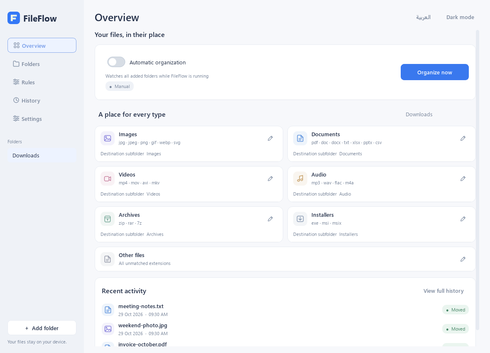
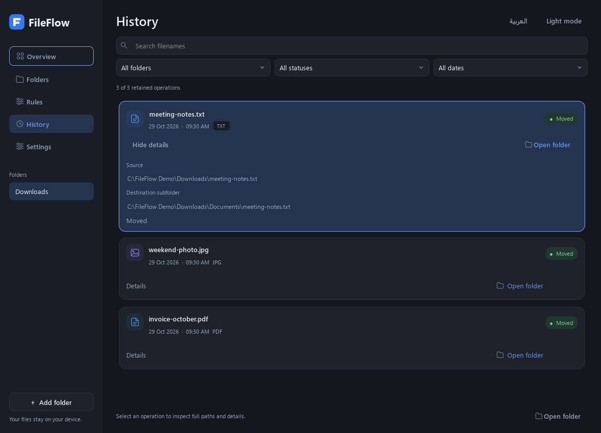
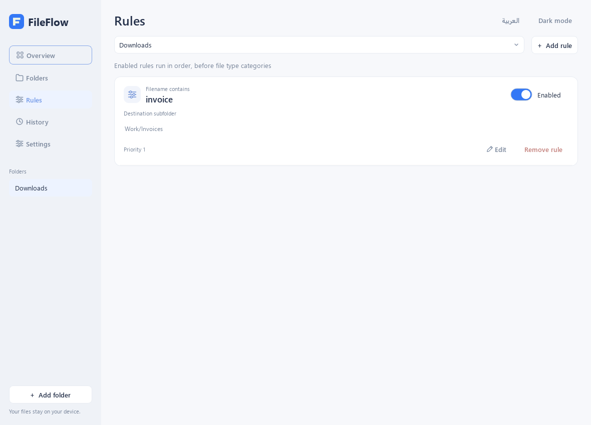
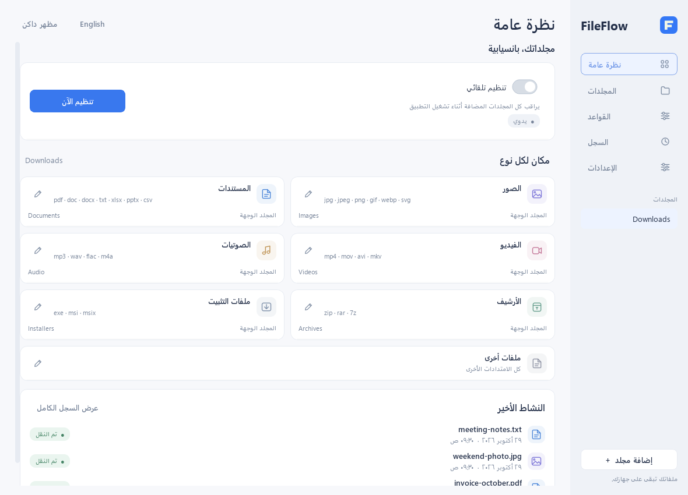

# FileFlow

**Your files, automatically organized.**

FileFlow is a lightweight Windows desktop application that automatically organizes
files into folders based on their type and customizable rules.


[](https://github.com/Mohammed-Alharbi-1/FileFlow/actions/workflows/ci.yml)


**[Download FileFlow for Windows](https://github.com/Mohammed-Alharbi-1/FileFlow/releases/tag/v1.2.2)** ·
[العربية](docs/README.ar.md) · [User guide](docs/user-guide.md) · [Changelog](CHANGELOG.md)

> The original source license is deferred. No general project software license
> has been granted. See [licensing status](LICENSING.md).



| Activity History · dark mode | Custom rules · light mode |
|---|---|
|  |  |



Screenshots use fictional demonstration files and paths.

## What FileFlow does

- Organizes images, documents, video, audio, archives, installers and other files.
- Watches multiple folders while running, including when closed to the system tray.
- Applies enabled extension or filename-contains rules before category defaults.
- Lets you choose relative destination folders and organize manually.
- Keeps the latest 200 History records with filename, folder, date and status filters.
- Provides expandable details, selectable paths and Open Folder actions.
- Supports Arabic RTL, English LTR, light/dark themes and native controls.
- Uses viewport-painted History to keep full-history background operation light.

No accounts, cloud service, backend, database, Electron or AI integration.

## How it works

1. Add a folder and confirm setup.
2. Customize category destinations or add simple rules.
3. Enable automatic organization, or choose **Organize Now**.
4. Leave FileFlow running; optional tray mode keeps monitoring active when hidden.

For example, `Downloads/photo.jpg` moves to `Downloads/Images/photo.jpg`.
A filename rule containing `invoice` can route `invoice-october.pdf` to
`Downloads/Work/Invoices/`. Existing nested folders are not rearranged.

## Install the portable app

Download the complete ZIP when the owner publishes it, extract **all files**, and
open `FileFlow.exe`. Keep `_internal` beside it. Python is not required. There is
no installer or automatic updater. Binaries are **unsigned**; Windows may display
reputation/security warnings. Verify the download and checksum before deciding
whether to run it; do not disable Windows security protections.

Windows 11 x64 was tested locally. Windows 10 x64 remains a target, not a completed
validation claim. See [getting started](docs/getting-started.md).

## Run or build from source

Run from the repository root in PowerShell with Python 3.12 x64 installed:

```powershell
py -3.12 -m venv .venv
.\.venv\Scripts\python.exe -m pip install -r requirements-dev.txt
.\.venv\Scripts\python.exe main.py
.\.venv\Scripts\python.exe -m pytest -q --tb=short
.\build.ps1
```

The build runs on Windows and writes to a new `dist/public-release/` directory,
never an older stable distribution. See [architecture](docs/architecture.md)
and [contributing](CONTRIBUTING.md).

## Resource usage

Historical local 1.2.2 measurements with 200 records reduced controlled packaged
hidden Private Bytes from 90.97 to 41.40 MiB. Private Working Set was 85.84 to
36.67 MiB. These are different metrics: Working Set also includes shared resident
pages. The user's roughly 35.9 MB Task Manager observation is a single-device
example, not a guarantee. Results depend on folders, rules, workload and runtime.
See [validation](docs/validation-summary.md) for methodology and current checks.

## File safety

FileFlow waits for stable file metadata, avoids overwriting existing destinations
by adding numbered suffixes, ignores temporary downloads such as `.crdownload`,
`.part` and `.tmp`, validates folder routes, and reports locked/inaccessible files.
Monitoring is nonrecursive. Rules use relative destinations inside their folder.
Quit cooperatively stops monitoring and pending waits while allowing an entered
move to finish safely. **There is no automatic undo, recovery bin or backup
feature.** Review destinations and maintain your usual backups.

## Roadmap

Planned possibilities, not existing features: a Windows installer, optional
startup integration, further reliability testing and user-requested improvements.

## License and credits

The original-source license decision is deferred; no general software license
has been granted. See [licensing status](LICENSING.md). Python, PySide6/Qt,
Shiboken, watchdog and the PyInstaller bootloader retain their own terms.
The portable ZIP includes corresponding Qt/PySide/Shiboken source archives,
license texts and notices; [library replacement rights](THIRD_PARTY_RIGHTS.md)
remain available. See [third-party notices](THIRD_PARTY_NOTICES.md).
FileFlow uses original branding and vector icons; no Apple or Hazel code/assets
are included.
